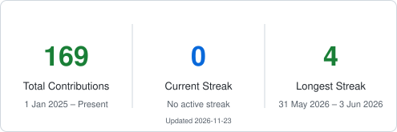

# ECZ Quantum Labs

**Deep-tech invention studio · Zürich, Switzerland**

UID CHE-387.152.530

---

## What we build

Independent, bootstrapped research and engineering: photonic computing, secure communication, and verification tooling for trustworthy AI.

## Public projects

| Project | What it is |
| :-- | :-- |
| [**Swiss AI Trust Tag**](https://github.com/SwissAITrustTag) | Neutral, reproducible benchmarking and certification for AI models. Audit manifests are public and cryptographically sealed. |
| [**Light Carpet**](https://github.com/ECZ-Quantum-Labs/light-carpet) | Hybrid photonic-mechanical computing fabric. Public, non-sensitive overview with a [Zenodo record](https://doi.org/10.5281/zenodo.20378834). |
| [**Sovereign Shield**](https://github.com/ECZ-Quantum-Labs/ECZ-Stratos-Kafka-Sovereign-Shield) | Zero-trust anti-fraud layer for API platforms. |
| [**ECP Titanium**](https://github.com/ECZ-Quantum-Labs/ecp-titanium-nvidia) | Ephemeral communication protocol with signed deletion receipts. |

## Activity

<picture>
  <source media="(prefers-color-scheme: dark)" srcset="https://raw.githubusercontent.com/ECZ-Quantum-Labs/ECZ-Quantum-Labs/output/snake-dark.svg">
  
</picture>

<picture>
  <source media="(prefers-color-scheme: dark)" srcset="assets/streak-dark.svg">
  
</picture>

The animation and statistics are generated by GitHub Actions in this repository. No external image service is involved.
